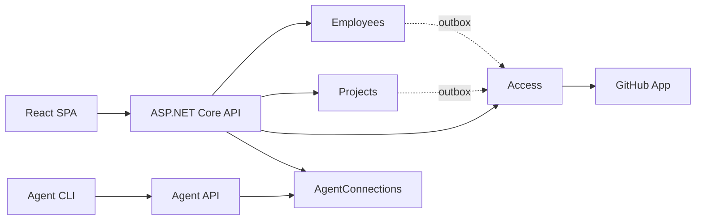

# AI-first development platform

[](#статус)
[](#стек)
[](#стек)
[](#стек)
[](#стек)

Платформа связывает сотрудников, проекты, агентов и правила компании. Сотрудник получает проект целиком: репозитории, доступ и инструкцию для агента. Агент подключается личным токеном и действует только от имени сотрудника.

Репозиторий сейчас содержит **спецификацию и архитектурные решения**. Код приложения начинается со среза 0 по `docs/technical-foundation/implementation-plan.md`.

## Что решает

- Приглашение и вход сотрудника без переписки в чате.
- Проект объединяет сервисы, у каждого сервиса один GitHub-репозиторий.
- Доступ к проекту синхронизируется с командой GitHub через GitHub App.
- Агент подключается персональным токеном и не получает прав шире сотрудника.
- При уходе сотрудника доступ и токены отзываются одной операцией.

## Сценарии MVP

| Сценарий | Результат |
| --- | --- |
| S1. Приглашение и вход | У сотрудника есть учётная запись и свои проекты |
| S2. Проект и репозитории | Проект содержит сервисы, репозитории и инструкцию |
| S3. Доступ к проекту | Членство в проекте и доступ на GitHub совпадают |
| S4. Подключение агента | Агент подключён и действует от имени сотрудника |
| S5. Работа агента | Агент готовит окружение и проверяет доступ |
| S6. Деактивация | Человек и его агент теряют доступ одновременно |

Подробно: `docs/first-version.md`.

## Архитектура



Модульный монолит с вертикальными срезами. Четыре модуля: `Employees`, `Projects`, `Access`, `AgentConnections`. У каждого модуля своя схема PostgreSQL и свой `DbContext`. Межмодульные запросы идут через `*.Contracts`, побочные действия — через транзакционный outbox.

## Стек

- Backend: ASP.NET Core на .NET 10 LTS, EF Core, PostgreSQL 17.
- Frontend: React, TypeScript, Vite.
- API: REST, OpenAPI, Problem Details.
- Окружение: Docker Compose.
- ID: UUID v7.

Подробно: `docs/technical-foundation/README.md`.

## Агент

- REST API и CLI.
- Один endpoint: `GET /api/agent/v1/bootstrap`.
- Bearer-токен, только чтение.
- Возвращает компанию, проекты, сервисы, репозитории и инструкции.
- MCP-адаптер — позже.

## Документы

| Документ | Что внутри |
| --- | --- |
| `docs/first-version.md` | Границы MVP и сценарии S1–S6 |
| `docs/technical-foundation/README.md` | Стек, модули, данные, API, GitHub App |
| `docs/technical-foundation/implementation-plan.md` | Срезы 0–7 и критерии приёмки |
| `docs/technical-foundation/web-api-contract.md` | Контракт web API |
| `docs/adr/` | 12 архитектурных решений |
| `DOMAIN.md` | Словарь продукта и процесса |
| `AGENTS.md` | Правила работы агентов в репозитории |
| `docs/agents/agent-workflow.md` | Полный путь задачи |
| `scripts/README.md` | Проверки документации и кода |

## Проверки

```bash
node scripts/check-doc-links.mjs
node scripts/verify.mjs
```

`verify.mjs` пропускает недоступные проверки и печатает `skipped`. Полный набор: `node scripts/verify.mjs --full`.

## Статус

Спецификация готова к реализации. Следующий шаг — срез 0: скелет репозитория, Docker Compose, миграции, seed, health checks и OpenAPI. План — `docs/technical-foundation/implementation-plan.md`.
